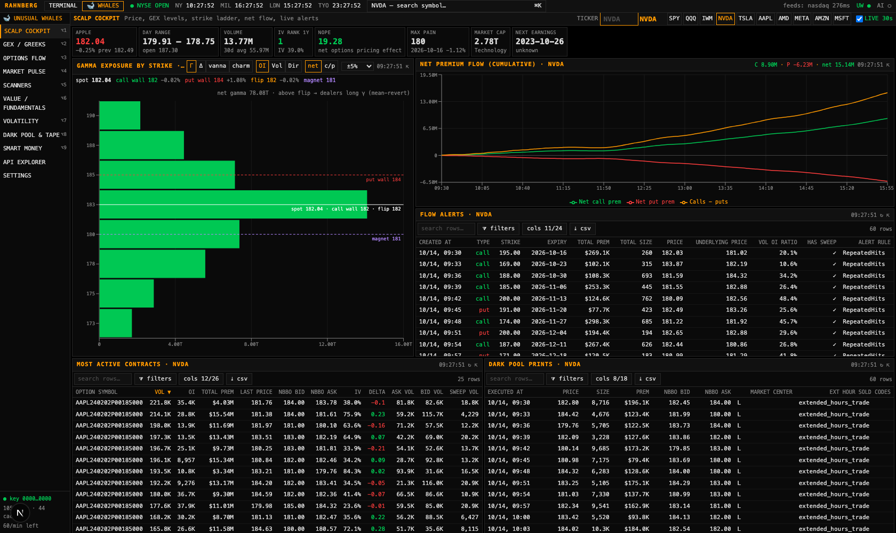

<div align="center">

# RahnbergTerminal — by Claude

**A Bloomberg Terminal‑style workspace, now wired into the entire Unusual Whales API.**

Dark. Dense. Keyboard‑driven. Free public market data for the widget terminal, plus a dedicated
🐋 **WHALES** page covering all 230 Unusual Whales endpoints: GEX, options flow, scanners, dark pool,
volatility, fundamentals and smart money.



<sub>Forked from <a href="https://github.com/nornosnibor/RahnbergTerminal">RahnbergTerminal</a> (itself based on OpenTerminal). Screenshots use the bundled mock data.</sub>

</div>

<br/>

## 🐋 The WHALES page (Unusual Whales)

Switch with the **🐋 WHALES** tab in the top bar or **⌥W**. Sections are on **⌥1–⌥9**. Every per-ticker panel follows
the active symbol (type it in the header or use ⌘K). Clicking a ticker in any table loads it everywhere.

| Section | What it's for |
|---|---|
| **Scalp Cockpit** | One-screen view for intraday trading: price/range/volume, IV rank, NOPE, max pain, **GEX call wall / put wall / gamma flip / magnet** with % distance from spot, a **strike‑ladder GEX chart** (Γ/Δ/vanna/charm · OI / volume / directionalized · net or call/put), cumulative **net premium flow**, live **flow alerts**, **most active contracts**, **dark pool prints**, flow by expiry and dark pool price levels |
| **GEX / Greeks** | Spot GEX by strike, exposure by strike for a single expiry, exposure by expiry, exposure per 1% move intraday, net gamma history, directional delta/vega flow, OI per strike, max pain / expiry breakdown |
| **Options Flow** | Market‑wide flow alerts with 12 one‑click presets (Unusual, Whale prints ≥ $1M, 0DTE scalps, sweeps, bullish calls, bearish puts, size > OI, earnings plays, LEAPS, floor, small caps…), filter bar, call/put premium split and net premium by ticker. Also: unusual options activity, **hottest chains** (7 presets), multi‑leg trades, OI change leaders |
| **Market Pulse** | Market tide, sector tide, ETF tide, top net premium impact, sector ETFs, movers, economic & FDA calendars, pre/after‑market earnings, headlines, total options volume, net flow by expiry, insider buy/sell totals |
| **Scanners** | UW stock screener with 13 presets (momentum, IV rank, gamma flips, **value: dividend large caps / near 52‑week low / insider buying**, 2σ moves…), all 112 filters, a **query‑language box**, **saved scans**, a **watchlist multi‑scan** (run GEX levels / IV rank / max pain / NOPE / short interest… across up to 60 tickers), short‑squeeze screener, analyst ratings, options pulse |
| **Value / Fundamentals** | P/E, PEG, EPS, yield, analyst target upside, 52‑week range position, short % float; revenue & net income chart; income / balance / cash‑flow statements (with computed free cash flow); earnings surprises & estimates; analyst ratings; institutional ownership; insiders; dividends; seasonality |
| **Volatility** | IV vs RV with a rich/cheap read, term structure, IV rank history, risk‑reversal skew, variance risk premium, anomaly/character/sentiment scores, market‑wide top anomalies, VIX term structure |
| **Dark Pool & Tape** | Market dark pool and lit prints (min size, sort by $/size/time), dark vs lit volume by price, ticker prints, short volume by exchange, FTDs |
| **Smart Money** | Congress trades (recent, unusual, late, per ticker), insider transactions, 13F filings with institution lookup (holdings, sectors, activity), politician portfolios |
| **API Explorer** | **All 230 endpoints**, searchable and grouped, with a parameter form generated from the official spec. Results appear as a table, as sub‑tables, or as raw JSON, and you can copy a curl command. Every panel's **⇱** opens its exact request here. Write endpoints (watchlists, alerts) ask for confirmation before sending |
| **Settings** | Save / verify / remove your API key, auto‑refresh interval, usage and the rate‑limit headers UW reports |

**Every table** sorts by column and has per‑column filters (`>1m`, `<0.5`, `10..20`, `=call`, `!put`, `spy|qqq`), a column picker and CSV export.

### Connecting your key

1. Get your token at unusualwhales.com/dashboard/api (it's a UUID).
2. Either paste it into **WHALES → Settings** (stored only in the local SQLite DB under `data/`, which is git‑ignored), or put
   `UW_API_KEY=…` in a `.env` file at the repo root (see `.env.example`).

The key never reaches the browser. All requests go through the local server, which:

- only forwards paths that exist in the endpoint catalog;
- keeps your requests under your plan's per‑minute limit (configurable with `UW_MAX_RPM`) and caches identical live requests for about 10 seconds;
- falls back to the last good response on 429/5xx;
- refuses requests from other websites' origins, so they can't spend your quota.

### Try it without a key

```bash
npm install
npm run dev:mock      # mock Unusual Whales API on :4100 + terminal on :3000
```

### Tests

```bash
npm test              # server (proxy hits all 221 GET endpoints against the mock) + web unit tests
npm run dev:mock      # then, in another terminal:
npx playwright install chromium && npm run test:e2e   # headless browser walk-through of every section
```

The endpoint catalog is generated from UW's OpenAPI spec. If UW adds endpoints, refresh it with `npm run gen:uw`.

<br/>

## Why OpenTerminal?

Real trading terminals cost **$2,000+ a month**. Most retail dashboards either lock the good stuff behind a paywall or run on a single flaky data source that breaks the moment you actually need it.

OpenTerminal takes a different approach: it stitches together several **free, publicly documented (or reverse‑engineered but widely used) market data endpoints** — the same ones that power major finance sites' own front ends — into one fast, keyboard‑first, widget‑based dashboard that runs entirely on your machine. Every data endpoint has an automatic fallback chain, so a single provider hiccup never takes the whole app down.

No signup. No credit card. No rate‑limited demo tier. Clone it, `npm install`, and you have a live terminal in under a minute.

<br/>

## ✨ Features

- 🖥️ **Widget-based workspace** — drag, resize, add, and remove panels (`react-grid-layout`); your layout is saved locally and restored on reload
- ⌘K **global command palette** — instantly search stocks, ETFs, and crypto and jump straight to them
- 📈 **Professional charting** (via [`lightweight-charts`](https://github.com/tradingview/lightweight-charts)) — candlesticks, bars, line, area, volume, 8 timeframes (1D → MAX), and SMA / EMA / VWAP / Bollinger Bands / RSI / MACD indicators, each with a live hover legend showing OHLC, volume, and every active indicator's value under your cursor
- 💹 **Quote panel** — last / bid / ask / OHLC, volume, market cap, P/E, EPS, dividend yield, 52‑week range, beta, shares outstanding
- 📰 **News feed** — aggregated and de‑duplicated from multiple RSS sources, per‑symbol or global
- 🔎 **Full‑market screener** — filter by sector, market cap, % change, and volume across the entire US equity market, sortable on every column
- 🗺️ **Live sector heatmap** — treemap sized by market cap, colored by daily % change, refreshing every few seconds
- ⛓️ **Options chain** — calls and puts side‑by‑side with strike, bid/ask, volume, open interest, and ITM highlighting
- 🪙 **Crypto board** — top assets with 7‑day sparklines, BTC/ETH dominance, and full OHLCV charting for any listed coin
- 🏦 **Macro dashboard** — live US Treasury yield curve, VIX, and major index/commodity proxies
- 💼 **Portfolio tracker** — log buy/sell transactions, track average cost, realized & unrealized P&L (persisted in SQLite)
- 🤖 **AI assistant** (optional) — ask questions about the symbol you're looking at, powered by Claude, fully context‑aware of the terminal's current data
- ⚡ **Near real‑time updates** — quotes and indexes refresh every second with a subtle flash on change, so you always know what just moved
- ⌨️ **Keyboard shortcuts** everywhere — `⌘K` to search, `⌥1`–`⌥9` to add any widget

<br/>

## 📸 A closer look

### Charting

Candlesticks, bars, line, or area — 8 timeframes, six technical indicators, and a live legend under your cursor showing OHLC, volume, and every active indicator's value for the candle you're pointing at.


<br/>

### Live sector heatmap

The whole US equity market as a treemap — sized by market cap, colored by daily % change, refreshing every few seconds so nothing you're watching ever goes stale.


<br/>

### Crypto

Top assets with 7‑day sparklines and BTC/ETH dominance — click through to full OHLCV candlestick charting for any listed coin, same charting engine as stocks.


<br/>

### News

Headlines aggregated and de‑duplicated across multiple sources, filterable per‑symbol or global, so you're never digging through five tabs to catch up.


<br/>

## 🗂️ Data sources

No paid API, no keys, and no single point of failure — every endpoint has a fallback chain, and results are cached with a stale‑while‑revalidate strategy so a temporary outage never blanks out the UI.

| Data | Primary source | Fallback |
|---|---|---|
| Quotes (stocks/ETFs) | Nasdaq public quote API | Yahoo Finance → Stooq |
| Fundamentals (P/E, EPS, beta, div yield) | TradingView scanner API | — |
| Historical candles | Nasdaq chart API | Yahoo Finance → Stooq |
| Symbol search | TradingView symbol search | Yahoo Finance |
| Full‑market screener / heatmap | TradingView scanner API (live, whole US market) | — |
| Options chain | Nasdaq option‑chain API | Yahoo Finance |
| News | Yahoo Finance RSS | Google News RSS |
| Crypto quotes & board | CoinGecko | Binance public API |
| Crypto candles | Binance public API (klines) | — |
| Macro (Treasury yields, VIX) | FRED (Federal Reserve) | — |

> ⚠️ These are public endpoints, not officially licensed data feeds — treat prices as delayed/indicative, not execution‑grade. See [`server/src/providers/`](server/src/providers) — each provider is a small, isolated module, so swapping or adding a data source is a 30‑minute job.

<br/>

## 🚀 Quick start

```bash
git clone https://github.com/nornosnibor/RahnbergTerminal-by-Claude.git
cd RahnbergTerminal-by-Claude
npm install
npm run dev
```

- Web UI → **http://localhost:3000**
- API health → **http://localhost:4000/api/status**

That's it — no `.env` file required to get a fully working terminal.

### Optional: AI assistant

```bash
export ANTHROPIC_API_KEY=sk-ant-...
npm run dev
```

Without a key, everything else still works — the AI widget just shows a friendly "unavailable" message instead of failing.

<br/>

## 🐳 Docker

```bash
docker compose up --build
```

Portfolio data persists in the `terminal-data` volume (SQLite, WAL mode).

<br/>

## 🧱 Tech stack

| Layer | Stack |
|---|---|
| Frontend | Next.js 15 · React 19 · TypeScript · Tailwind CSS 4 · Zustand · TanStack Query |
| Charts | `lightweight-charts` (candles/indicators) · D3 (heatmap treemap) · Recharts (yield curve) |
| Backend | Node.js · Express · TypeScript |
| Database | SQLite (`better-sqlite3`, WAL mode) |
| AI | Anthropic Claude (optional) |

<br/>

## 📁 Project structure

```
├── server/                  # Express + TypeScript API
│   └── src/
│       ├── providers/       # nasdaq, tradingview, yahoo, stooq, fred, coingecko, binance, news
│       ├── routes/          # market, portfolio, ai, uw (Unusual Whales proxy + scans)
│       ├── uw/              # endpoint catalog (generated), client, mock UW server
│       ├── cache.ts         # TTL cache with stale-while-revalidate fallback
│       └── db.ts            # SQLite (better-sqlite3, WAL)
└── web/                      # Next.js 15 + React 19 + Tailwind 4
    ├── components/           # TopBar, Sidebar, Workspace, CommandPalette
    ├── components/widgets/   # Chart, Quote, Watchlist, News, Screener, Heatmap, Crypto, Options, Macro, Portfolio, AI
    ├── components/whales/    # WHALES page: sections, DataTable, charts, ParamForm
    ├── lib/                  # API client, technical indicators
    └── store/                # Zustand store (workspace layout, persisted)
```

Run tests with `npm test` (Vitest, no network calls). CI runs on every push — see [`.github/workflows/ci.yml`](.github/workflows/ci.yml).

<br/>

## 🗺️ Roadmap

- [ ] Multiple workspaces / tabs
- [ ] Economic calendar (Fed / ECB / CPI / NFP)
- [ ] Chart drawing tools & multi‑asset comparison overlay
- [ ] Black‑Scholes Greeks on the options chain
- [ ] Price alerts with desktop notifications
- [ ] PostgreSQL as an alternative to SQLite

Have an idea? [Open an issue](../../issues) — contributions are very welcome.

<br/>

## 🤝 Contributing

Pull requests are welcome, especially:
- New or more resilient data providers (`server/src/providers/`)
- New widgets (`web/components/widgets/`)
- Bug fixes and UI polish

Please open an issue first for anything non‑trivial so we can align on approach before you invest the time.

<br/>

## ⚖️ Disclaimer

For personal and educational use only. Market data comes from public endpoints and may be delayed, incomplete, or occasionally wrong — **do not use this for real investment decisions**. Respect the terms of service of the underlying data providers.

## License

[MIT](LICENSE)

<br/>

<div align="center">

**star the repo** ⭐ — it's the best way to support the project.

</div>
